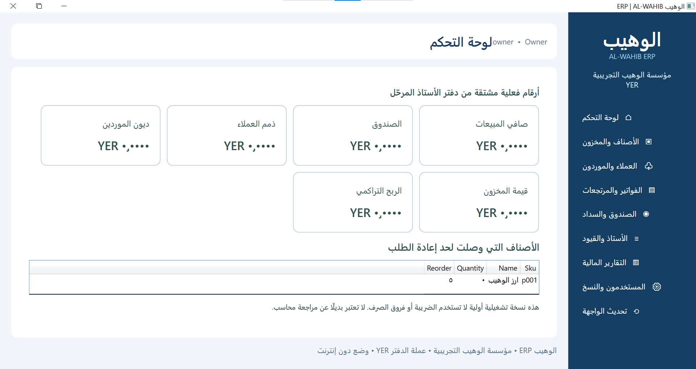

# الوهيب ERP | AlWahibERP

**نظام محاسبي مكتبي تجريبي يعمل دون اتصال دائم بالإنترنت**

**تطوير:** وهيب الكبودي | Wahib Al-Kaboudi  
**المنصة:** Windows Desktop  
**التقنيات:** C# · .NET 10 · WPF · SQLite

## نبذة عن المشروع

الوهيب ERP نموذج لنظام محاسبي مكتبي يعمل على Windows ويجمع العمليات المالية وإدارة المخزون في بنية تطبيق متعددة الطبقات.

## الوظائف والمكونات الأساسية

- الأصناف والمخزون والعملاء والموردون.
- فواتير البيع والشراء والمرتجعات.
- الصندوق والسداد والحسابات والقيود المحاسبية.
- التقارير المالية والمستخدمون والصلاحيات والنسخ الاحتياطي.
- بنية برمجية مقسمة إلى Domain وApplication وInfrastructure وDesktop وTests.

## صور ومخططات المشروع



### بقية الواجهات

- [02 inventory](screenshots/02-inventory.png)
- [03 add product](screenshots/03-add-product.png)
- [04 stock count](screenshots/04-stock-count.png)
- [05 customers suppliers](screenshots/05-customers-suppliers.png)
- [06 invoices returns](screenshots/06-invoices-returns.png)
- [07 purchase invoice](screenshots/07-purchase-invoice.png)
- [08 cash payments](screenshots/08-cash-payments.png)
- [09 ledger accounts](screenshots/09-ledger-accounts.png)
- [10 financial reports](screenshots/10-financial-reports.png)
- [11 administration](screenshots/11-administration.png)

## التقنيات المستخدمة

C# · .NET 10 · WPF · SQLite

## التشغيل محليًا

```powershell
dotnet restore
dotnet build
dotnet run --project src/Wahib.Desktop/Wahib.Desktop.csproj
```

## حالة المشروع وحدوده

نموذج أولي، وليس ERP إنتاجيًا كاملًا. لا تدعم النسخة الحالية جميع متطلبات الضرائب وفروق الصرف والسيناريوهات التجارية المتقدمة.

## المطور وحقوق النشر

**وهيب الكبودي | Wahib Al-Kaboudi**  
Copyright © 2026 Wahib Al-Kaboudi. All rights reserved.

ما لم يُذكر ترخيص صريح آخر للملفات أو التبعيات، فإن نشر المصدر هنا لا يمنح تلقائيًا إذنًا بإعادة توزيعه أو استخدامه تجاريًا. تُحترم تراخيص المكتبات والبيانات والمكونات الخارجية كلٌّ بحسب شروطه.
