# الوهيب ERP — نظام محاسبي مكتبي تجريبي

**AlWahib ERP** تطبيق Windows مكتبي مبني بلغة **C#** وإطار **.NET 10** وواجهات **WPF** وقاعدة **SQLite**. يركز على إدارة العمليات المالية والأصناف والفواتير لمؤسسة واحدة على جهاز محلي، دون الحاجة لاتصال دائم بالإنترنت.

[English README](README.md) · [حالة المشروع التفصيلية](docs/PROJECT_STATUS.md) · [خطوات الرفع على GitHub](docs/GITHUB_UPLOAD_AR.md)

> **الحالة: نموذج أولي قابل للتطوير.** لدينا كود الوظائف وصور حقيقية لواجهات التشغيل، لكن لا ندعي أن جميع الوظائف اختُبرت أو أن المنتج معتمد للاستخدام المالي التجاري.

## معاينة لوحة التحكم

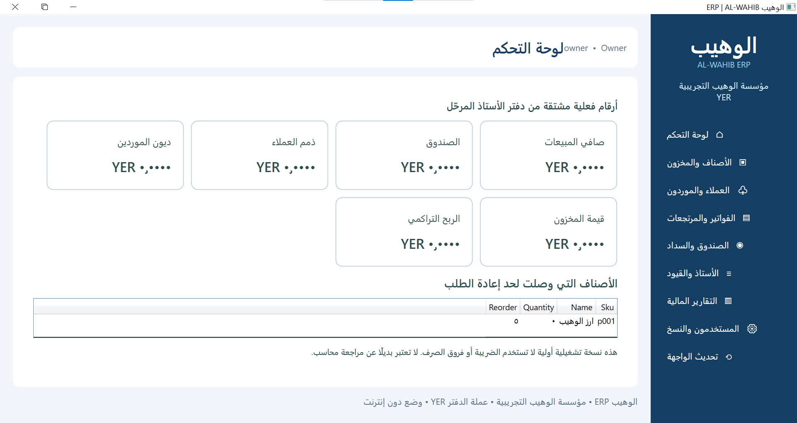

*لقطة أصلية لواجهة لوحة التحكم من شركة تجريبية، نوفمبر 2026.*

## معرض صور الواجهات الحقيقية

هذه لقطات أصلية من التطبيق على Windows، مأخوذة من بيانات تجريبية في نوفمبر 2026. وهي توضح الواجهات والنماذج المعروضة، **ولا تعني التحقق من نجاح كل عملية**.

| الواجهة | الواجهة |
|:---:|:---:|
| <a href="screenshots/02-inventory.png">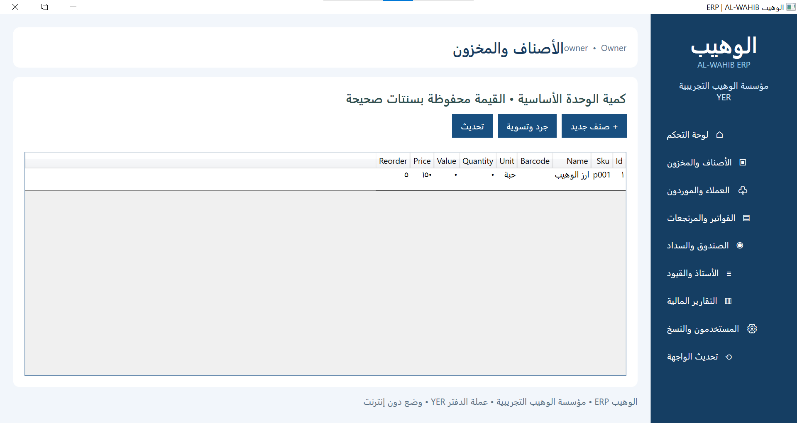</a><br><strong>الأصناف والمخزون</strong><br>عرض الأصناف والكميات والأسعار وأوامر الإضافة والجرد | <a href="screenshots/05-customers-suppliers.png">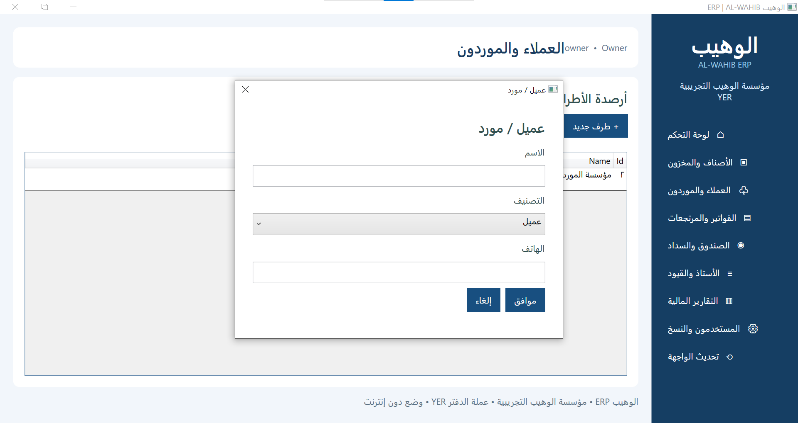</a><br><strong>العملاء والموردون</strong><br>إدارة جهات التعامل ونموذج إضافة عميل أو مورد |
| <a href="screenshots/06-invoices-returns.png">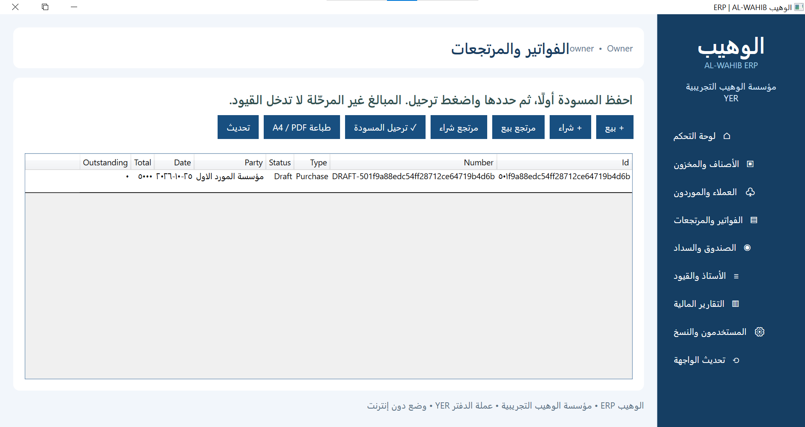</a><br><strong>الفواتير والمرتجعات</strong><br>قائمة المستندات ومسودات الفواتير وخيارات البيع والشراء والترحيل | <a href="screenshots/08-cash-payments.png">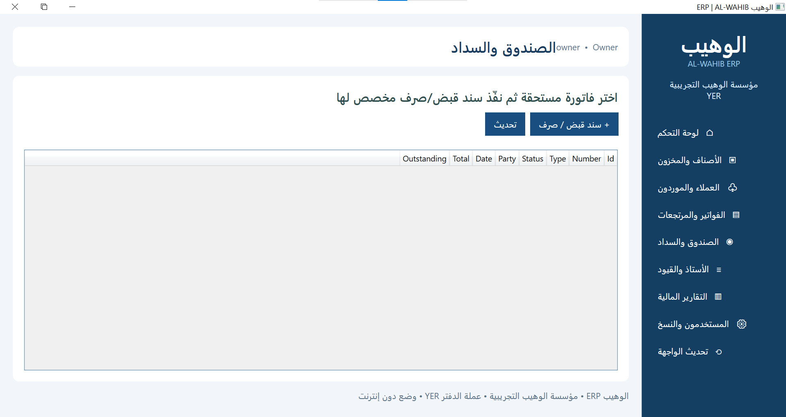</a><br><strong>الصندوق والسداد</strong><br>صفحة إنشاء سند قبض أو صرف وعرض المستحقات |
| <a href="screenshots/09-ledger-accounts.png">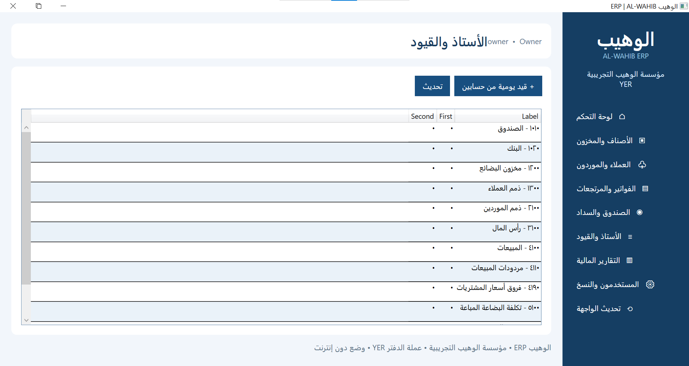</a><br><strong>الأستاذ والقيود</strong><br>شجرة/قائمة الحسابات وإمكانية إدخال قيود يومية | <a href="screenshots/10-financial-reports.png">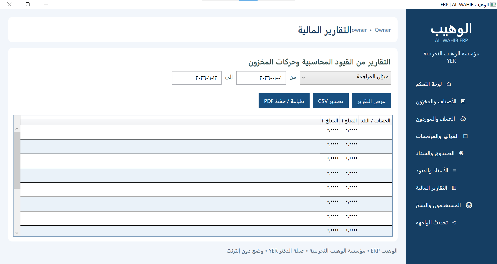</a><br><strong>التقارير المالية</strong><br>استعراض ميزان المراجعة والتصدير إلى CSV والطباعة |
| <a href="screenshots/11-administration.png">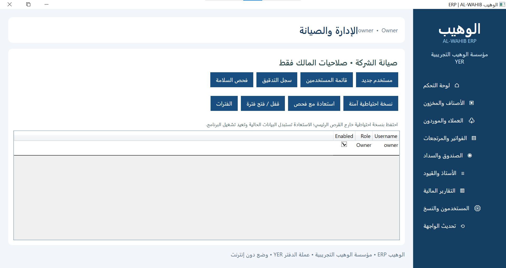</a><br>**الإدارة والنسخ الاحتياطي**<br>إدارة المستخدمين والتدقيق والنسخ الاحتياطية والفترات | — |

<details>
<summary>عرض النوافذ الإضافية: إضافة صنف، جرد صنف، فاتورة شراء</summary>

**إضافة صنف** — نموذج إنشاء صنف جديد مع SKU والوحدة والباركود والسعر

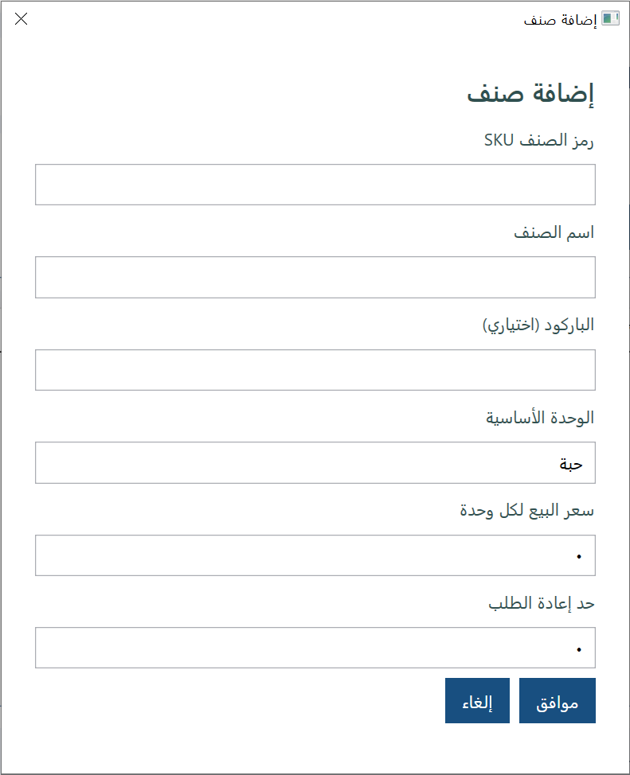

**جرد صنف** — نموذج تسجيل الكمية الفعلية وتاريخ الجرد وسبب الفرق

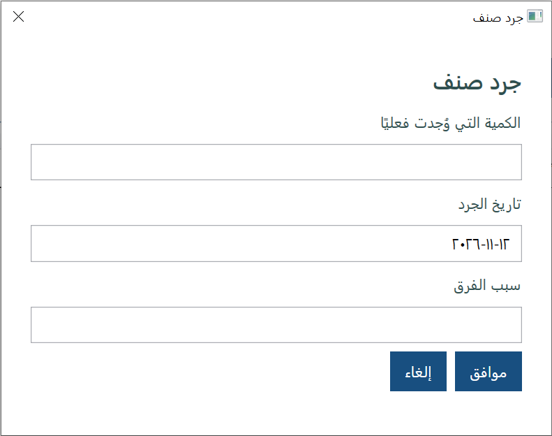

**إضافة فاتورة شراء** — نموذج إدخال فاتورة شراء واختيار المورد وطريقة السداد

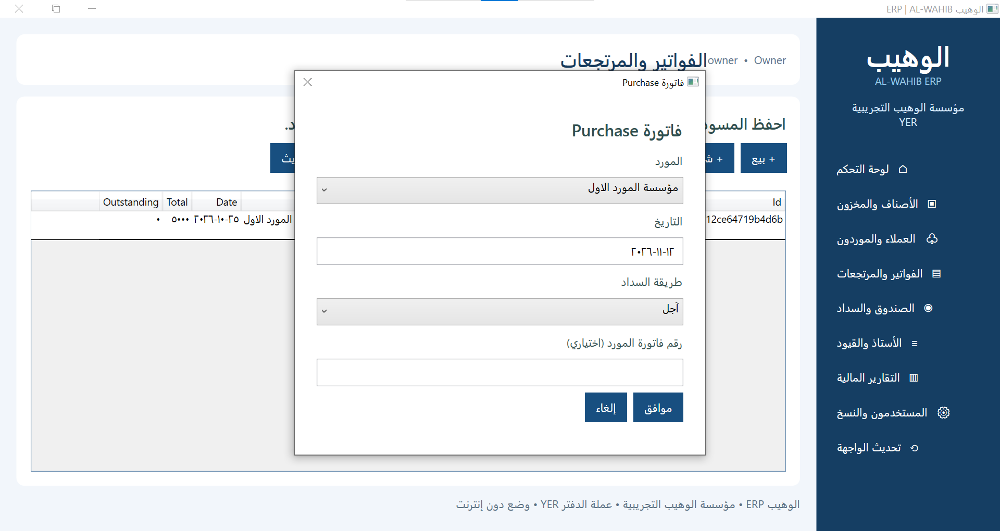

</details>

جميع الملفات الأصلية متاحة في [مجلد الصور](screenshots/README.md).

## المميزات المنفذة على مستوى الكود

1. **لوحة التحكم:** صافي المبيعات، الصندوق، الذمم، قيمة المخزون، الأرباح والتنبيه على الأصناف التي وصلت حد إعادة الطلب.
2. **الأصناف والمخزون:** إضافة أصناف برمز SKU وباركود اختياري وسعر ووحدة، عرض الكميات والقيم، جرد وتسوية.
3. **العملاء والموردون:** تعريف الأطراف وتصنيفها، وعرض أرصدتها المشتقة من القيود.
4. **الفواتير والمرتجعات:** إنشاء بيع وشراء ومرتجع، حفظ المسودات ثم ترحيلها، وطباعة A4 عبر مربع طباعة Windows.
5. **الصندوق والسداد:** قبض وصرف وسداد مرتبط بالمستندات المستحقة.
6. **الأستاذ والقيود:** قيود يومية مزدوجة، وحسابات وأستاذ وميزان مراجعة.
7. **التقارير:** قائمة الدخل، المركز المالي، الأستاذ، تقارير الفواتير والمخزون، وتصدير CSV.
8. **الإدارة:** حسابات مستخدمين وأدوار أساسية، فترات مقفلة، سجل تدقيق، فحص سلامة، نسخ احتياطي واستعادة.

هذه قائمة **بما هو موجود في ملفات الكود**؛ ليست شهادة نجاح اختبار جميع السيناريوهات. تفاصيل التنفيذ الجزئي والنواقص في [`docs/FEATURE_COVERAGE.csv`](docs/FEATURE_COVERAGE.csv).

## التقنيات

| التقنية | الاستخدام |
|---|---|
| C# / .NET 10 | لغة التطبيق وإطار التنفيذ |
| WPF / XAML | واجهة Windows عربية باتجاه RTL |
| SQLite / Microsoft.Data.Sqlite | حفظ بيانات الشركات محليًا والمعاملات المحاسبية |
| ADO.NET | تنفيذ SQL ومعاملات قاعدة البيانات مباشرة |
| PowerShell / CMD | أدوات التشغيل والبناء والنشر المحلي |

## بنية المشروع

```text
src/
├── Wahib.Domain/            ← المبالغ والقواعد المحاسبية
├── Wahib.Application/       ← العقود والكيانات الناقلة
├── Wahib.Infrastructure/    ← SQL والمستندات والتقارير والنسخ
└── Wahib.Desktop/           ← واجهات WPF

tests/Wahib.Tests/          ← سيناريوهات اختبار من سطر الأوامر
docs/                       ← المرجع الهندسي والحالة التفصيلية
screenshots/                ← صور حقيقية للتطبيق
```

المشروع مقسّم إلى طبقات، لكن تنفيذ واجهات WPF يعتمد حاليًا على code-behind وليس MVVM كاملًا، كما أن جزءًا من تنسيق عمليات الأعمال يقع في Infrastructure.

## طريقة التشغيل

**المتطلبات:** Windows 10/11، تثبيت .NET 10 SDK، واتصال إنترنت أول مرة عند الحاجة لتنزيل حزم NuGet.

من PowerShell في مجلد المشروع:

```powershell
dotnet restore .\AlWahibERP.slnx
dotnet build .\AlWahibERP.slnx -c Debug --no-restore
dotnet run --project .\src\Wahib.Desktop\Wahib.Desktop.csproj -c Debug --no-restore
```

أو شغّل `01-FIRST-RUN.cmd` (استعادة الاعتماديات + بناء + اختبارات مضمّنة + تشغيل). وبعد البناء يمكن استخدام `02-RUN-APP.cmd`.

أول مرة يُطلب إنشاء شركة وكلمة مرور. اسم المالك الأول `owner` **دون كلمة مرور افتراضية**. تُحفظ قواعد البيانات التشغيلية خارج الكود في `%LOCALAPPDATA%\AlWahibERP`.

لتشغيل سيناريوهات التحقق البرمجية:

```powershell
dotnet run --project .\tests\Wahib.Tests\Wahib.Tests.csproj
```

## حدود هذا الإصدار

- لا توجد محاسبة تعدد عملات وفروق صرف أو ضريبة معتمدة قانونيًا.
- لا توجد طابعة حرارية 80mm مدمجة أو تثبيت Windows رسمي موقّع.
- لا يوجد تشفير لملف SQLite ولا تنفيذ مكتمل للصلاحيات الدقيقة.
- بعض المتطلبات في المرجع الهندسي منفذة جزئيًا أو غير منفذة؛ انظر جدول التغطية.
- لم نجرِ في **جولة إعداد GitHub الحالية** بناءً جديدًا أو اختبار معاملات على Windows؛ صورة الواجهة تثبت ظهورها فقط.

**مهم:** لا تستخدم بيانات مالية حقيقية أو تعتمد عليه تجاريًا قبل تنفيذ [قائمة قبول Windows](docs/WINDOWS_ACCEPTANCE_CHECKLIST.md) ومراجعة محاسب مختص.

## ملفات إضافية

- [حالة المشروع والمراجعة السريعة](docs/PROJECT_STATUS.md)
- [خريطة الكود للمطور](docs/DEVELOPER_REFERENCE.md)
- [الملاحظات الهندسية](docs/ENGINEERING_NOTES.md)
- [جدول تغطية المتطلبات](docs/FEATURE_COVERAGE.csv)
- [دليل التثبيت الأصلي](INSTALL_AND_RUN_AR.txt)
- [دليل نشر المستودع](docs/GITHUB_UPLOAD_AR.md)

**الترخيص:** لا يوجد ترخيص مفتوح المصدر محدد حاليًا. يُضاف `LICENSE` فقط بعد اختيار صاحب المشروع لشروط مناسبة.
